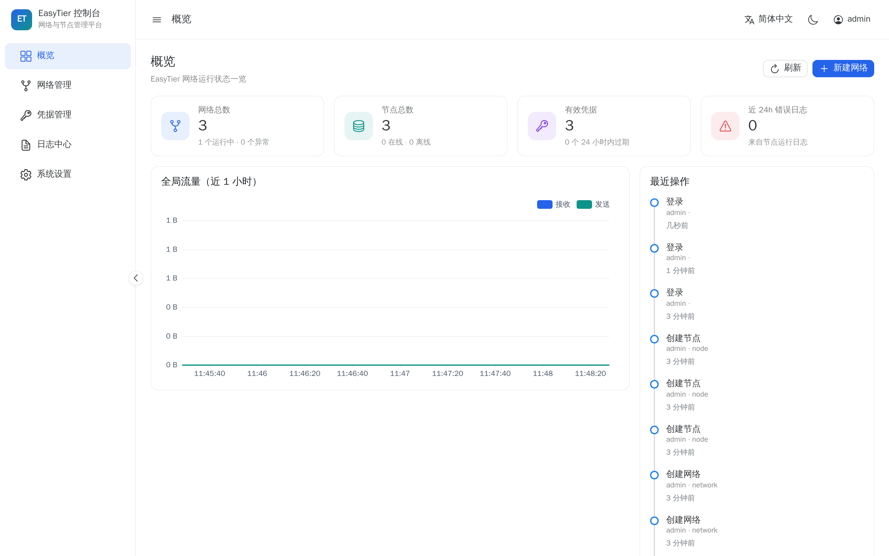
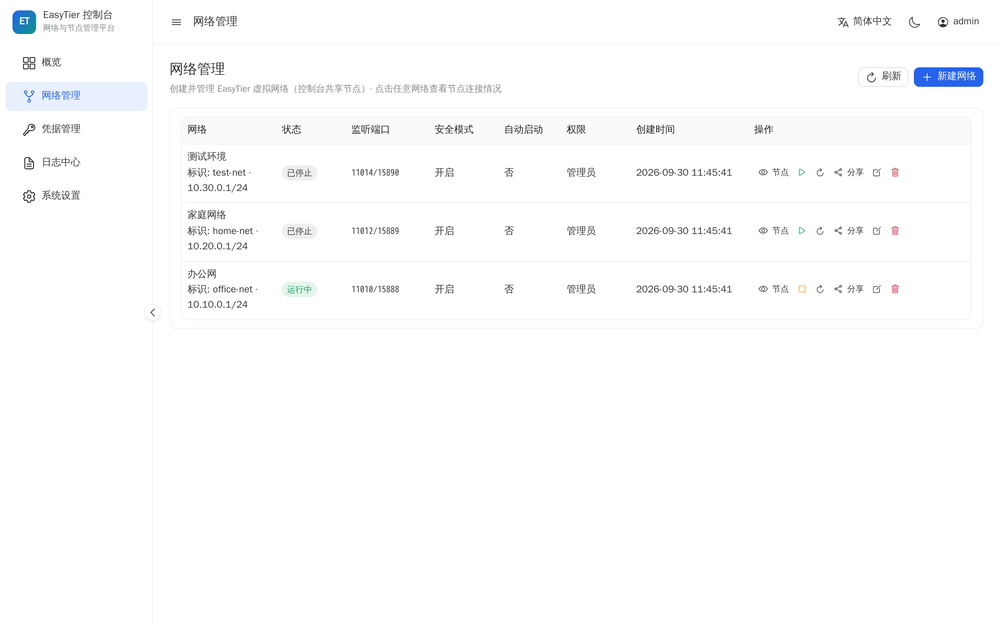

# EasyTier Console (easytier-admin)

[简体中文](./README.md) | [English](./README.en.md)

A visual network and node management console built on the official [EasyTier](https://easytier.cn/guide/introduction.html) **`easytier-core` / `easytier-cli`**.

- **Frontend**: Vue 3 + Vite + TypeScript + Naive UI + Pinia + Vue Router + Vue Flow + ECharts
- **Backend**: Rust + Axum + tokio + rusqlite (bundled SQLite) + AES-256-GCM / Argon2id
- **Node capabilities**: provided by `easytier-core`; the console reads node/route/credential/stats data through the `easytier-cli` RPC portal (`-p 127.0.0.1:<rpc-port>`)

> The console hosts each network's **shared node (relay / management node)** on the host and **issues temporary credentials** for client nodes. Clients join a network with a credential, so the network master secret never needs to be distributed.

---

## Screenshots

| Dashboard | Networks |
| --- | --- |
|  |  |

---

## Features

| Module | Description |
| --- | --- |
| Admin & accounts | First-run admin initialization; Argon2id password hashing; strong password policy; multi-user with roles (admin / operator / viewer); change / reset password |
| Network management | Create / edit / delete networks (shared-node instances), start / stop / restart, auto-start, automatic allocation of listen and RPC ports (occupied ports are excluded), secure mode with a fixed keypair and a KDF-derived `network_secret` |
| Node management | Create **fixed** nodes (join with `network_secret`, no credential) or **temporary** nodes (credential issued); automatic virtual-IP assignment; online status, latency, traffic, NAT type; one-click join command / `config.toml` / QR code |
| Topology | Render the live node connection graph (Vue Flow) from real-time peer data, distinguishing direct/relayed and online/offline |
| Credentials | Issue / list / revoke temporary credentials via `easytier-cli credential`, with TTL, ACL groups, relay permission, allowed proxy CIDRs and reuse flag |
| Multi-user & sharing | Networks are owned by their creator; non-admins only see networks they own or that are shared with them (admins see everything); share a network with `view` / `manage` permission; transfer ownership |
| Log center | Console audit log; real-time SSE streaming of `easytier-core` runtime logs plus persisted, searchable history |
| Dashboard | Network / node / credential statistics, global traffic chart (sampled every 30 s), recent operations and error logs |
| System settings | `easytier-core` / `easytier-cli` paths, default public shared node, port ranges, log retention, binary availability check |

---

## Architecture

```
┌──────────────────────────────────────────────────────────────┐
│                        Browser / Web frontend                 │
│   Vue3 + Naive UI + Vue Flow + ECharts (served by the backend)│
└───────────────▲──────────────────────────────┬───────────────┘
                │ REST / SSE (httpOnly Cookie)  │
┌───────────────┴──────────────────────────────▼───────────────┐
│                     Rust backend (Axum + tokio)               │
│  Auth · network/node/credential services · process manager    │
│  log collection · audit   SQLite(rusqlite) · AES-256-GCM      │
└───────┬───────────────────────────────┬──────────────────────┘
        │ child process                  │ RPC (JSON)
        ▼                               ▼
  easytier-core  ── shared node ───►  easytier-cli -p 127.0.0.1:<port> -o json
        │
        │ NAT traversal / relay
        ▼
  Client nodes (join with a credential, --secure-mode --credential)
```

The backend maps one-to-one to each network's shared node:

1. The console generates a TOML configuration file from the network settings.
2. It spawns `easytier-core -c <config.toml>` as a child process; this instance is the network's shared node / management node.
3. It communicates with that instance's RPC portal through `easytier-cli` to read peers, routes, node info, credentials and stats.
4. Client nodes join the network using credentials issued by the console.

---

## Quick start

### Prerequisites

- Node.js ≥ 20 (22+ recommended for development)
- Rust ≥ 1.75 (with cargo, to build the backend)
- pnpm ≥ 10
- `easytier-core` and `easytier-cli` installed (download from [EasyTier Releases](https://github.com/EasyTier/EasyTier/releases)) and on `PATH`, or point to absolute paths via `EASYTIER_CORE_PATH` / `EASYTIER_CLI_PATH`
- On Linux: `NET_ADMIN` capability and `/dev/net/tun` (to create the TUN device)

### 1. Local development

```bash
cp .env.example .env          # adjust ports, binary paths, etc. as needed
pnpm install
pnpm dev                      # start backend (:11211) and frontend (:5173) together
```

The frontend dev server proxies `/api` to the backend; open http://localhost:5173.

### 2. Production build (single process serves frontend + API)

```bash
pnpm install
pnpm build                    # build frontend dist + compile the Rust backend (release)
pnpm start                    # run the Rust backend, serving the frontend static files
# open http://<host>:11211
```

### 3. Docker deployment

```bash
# Fix APP_SECRET (used for JWT signing and sensitive-field encryption)
# Generate one with: openssl rand -base64 48
# and put it in the .env file at the project root (docker compose reads it automatically)
docker compose up -d --build
# open http://<host>:11211
```

Image notes:

- Multi-stage build: `rust:1-slim` compiles the backend into a **self-contained single-file binary** (rusqlite bundled; HTTP/SQLite/crypto dependencies inlined), `node:24-slim` builds the frontend, and the runtime is based on `debian:bookworm-slim` — **Node.js is no longer required at runtime**;
- The **statically linked** `easytier-core` / `easytier-cli` are copied from `EASYTIER_IMAGE` (default `easytier/easytier:latest`), so nothing has to be downloaded from GitHub or compiled inside the container;
- Dependencies use mirrors: npm → `registry.npmmirror.com`, crates → `rsproxy.cn`, Docker base images → DaoCloud.

Network modes:

- By default it uses bridge networking with port mappings, reachable at `http://localhost:<WEB_PORT>` (`WEB_PORT` defaults to `11211`, configurable in `.env`);
- EasyTier listen ports are mapped as `11011-11029` (tcp/udp) by default. If host ports are occupied, adjust `EASYTIER_LISTEN_PORT_START` in `.env` and the range in the compose file;
- **For production on a Linux host**, switch `docker-compose.yml` to `network_mode: host` (and remove the `ports` section) for the best NAT-traversal / P2P behavior; the shared node then uses host ports directly.

> You can also mount the host's EasyTier binaries (matching the host architecture):
> `-v /usr/local/bin/easytier-core:/usr/local/bin/easytier-core:ro`, keeping `EASYTIER_CORE_PATH` unchanged.

---

## First-run workflow

1. Open the console and use the **setup page** to create the admin account (password ≥ 12 chars with upper/lower case, digits and a special character).
2. **Networks → New network**: fill in the network name, the EasyTier network identifier (`network-name`), the virtual subnet (e.g. `10.126.126.1/24`) and an optional public shared node. **When secure mode is enabled you must set a network secret (`network_secret`)**; the value you type is transformed with Argon2id (KDF) before use and the plaintext is never stored. Then choose whether to start it immediately.
   - Once started, the network runs on an `easytier-core` shared node managed by the console.
3. **Networks → a network → Nodes → New node**: pick the network and the **node type** — **fixed** (joins with the network secret, no credential issued) or **temporary** (a credential is issued); the system assigns a virtual IP.
4. Click **Join** on a node to get a one-click command, a `config.toml` and a QR code; run it on the target device to join.
5. In the network detail page you can inspect **node details / liveness / topology / routes / credentials / runtime logs**.

There are two ways for clients to join (official scenario 1 and scenario 3):

**Fixed node** (`network_secret`, no `--credential`):

```bash
easytier-core -d \
  --network-name <network-name> \
  --network-secret '<KDF-derived-network-secret>' \
  --secure-mode \
  --local-private-key '<node-private-key-base64>' \
  --local-public-key '<node-public-key-base64>' \
  -p tcp://<shared-node>:11011
```

The `config.toml` generated by the console already contains `network_secret` and secure mode, so just start it:

```toml
instance_name = "office-node-1"
hostname = "node-1"
ipv4 = "10.126.126.2"
listeners = ["tcp://0.0.0.0:11010", "udp://0.0.0.0:11010"]

[network_identity]
network_name = "office"
network_secret = "<KDF-derived-network-secret>"

[secure_mode]
enabled = true
local_private_key = "<node-private-key-base64>"
local_public_key = "<node-public-key-base64>"

[[peer]]
uri = "tcp://shared-node.example.com:11011"
peer_public_key = "<shared-node-public-key-base64>"
```

```bash
easytier-core -c config.toml
```

**Temporary node** (credential; `--credential` implicitly enables secure mode, no `network_secret`):

```bash
easytier-core -d \
  --network-name <network-name> \
  --secure-mode \
  --credential <credential-secret> \
  -p tcp://<shared-node-or-public-node>:11010
```

The `config.toml` generated by the console has no `network_secret`, so pass the credential on the command line:

```toml
instance_name = "office-node-1"
hostname = "node-1"
ipv4 = "10.126.126.2"
listeners = ["tcp://0.0.0.0:11010", "udp://0.0.0.0:11010"]

[network_identity]
network_name = "office"

[secure_mode]
enabled = true

[[peer]]
uri = "tcp://shared-node.example.com:11010"
peer_public_key = "<shared-node-public-key-base64>"
```

```bash
easytier-core -c config.toml --credential <credential-secret>
```

---

## Environment variables

| Variable | Default | Description |
| --- | --- | --- |
| `HOST` | `0.0.0.0` | Backend listen address |
| `PORT` | `11211` | Backend / frontend port |
| `DATA_DIR` | `./data` | Directory for the database, network configs, credential files and logs |
| `APP_SECRET` | auto-generated | Master key for JWT signing and sensitive-field encryption (must be fixed in production) |
| `JWT_TTL` | `86400` | Login session lifetime (seconds) |
| `COOKIE_PERSIST` | `false` | Persist the login token cookie; by default it is a session cookie that expires when the browser closes |
| `COOKIE_SECURE` | `false` | Set to `true` when served over HTTPS |
| `TRUST_PROXY` | `false` | Trust `X-Forwarded-For` / `X-Real-IP` from a reverse proxy; enable only behind a trusted proxy |
| `SETUP_TOKEN` | empty | Optional first-run setup token; when set, `/api/auth/setup` must include it |
| `CORS_ORIGIN` | empty | Allowed CORS origins, comma-separated; can be empty for same-origin deployment |
| `FRONTEND_DIST` | `frontend/dist` | Frontend static assets directory |
| `EASYTIER_CORE_PATH` | `easytier-core` | Path to the `easytier-core` executable |
| `EASYTIER_CLI_PATH` | `easytier-cli` | Path to the `easytier-cli` executable |
| `EASYTIER_DEFAULT_EXTERNAL_NODE` | `tcp://public.easytier.cn:11010` | Default public shared node |
| `EASYTIER_RPC_PORT_START` | `15888` | Start of the per-network RPC portal ports |
| `EASYTIER_LISTEN_PORT_START` | `11010` | Start of the listen ports |
| `LOG_LEVEL` | `info` | Console log level |
| `WEB_PORT` | `11211` | Host web port for Docker Compose (compose only) |

> **Ports & firewall**: only the shared node's **listen ports** need to be reachable from outside (`EASYTIER_LISTEN_PORT_START` and up, tcp/udp; if a `ws` listener is used, also allow `listen port + 1`).
> Each network instance's **RPC portal port** (`EASYTIER_RPC_PORT_START` and up, default `15888`) is only used internally by the console via `easytier-cli -p 127.0.0.1:<port>`; it is bound to `127.0.0.1` and **does not need to — and should not — be exposed**.

The log retention period (in days, `0` = keep forever) can be configured in the app under **System settings**, not via an environment variable.

---

## API overview

All endpoints are prefixed with `/api`. Except for `/api/auth/status`, `/api/auth/setup`, `/api/auth/login` and `/api/system/health`, all require authentication (httpOnly Cookie).

| Method | Path | Description |
| --- | --- | --- |
| GET | `/api/auth/status` | Whether the system is initialized |
| POST | `/api/auth/setup` | Initialize the admin account |
| POST | `/api/auth/login` / `logout` | Log in / out |
| GET | `/api/auth/me` | Current user |
| POST | `/api/auth/change-password` | Change password |
| GET | `/api/users` | List users (admin) |
| POST/PATCH/DELETE | `/api/users[/:id]` | Create / update / delete users (admin) |
| POST | `/api/users/:id/reset-password` | Reset password (admin) |
| GET | `/api/users/selectable` | Minimal user list for sharing |
| GET/POST | `/api/networks` | List / create networks |
| GET/PATCH/DELETE | `/api/networks/:id` | Network detail / update / delete |
| POST | `/api/networks/:id/{start,stop,restart}` | Start / stop / restart |
| GET | `/api/networks/:id/{config,live,topology,peers,routes,logs,credentials,nodes}` | Network runtime information |
| GET/POST | `/api/networks/:id/shares` | List / add network shares (owner or admin) |
| DELETE | `/api/networks/:id/shares/:userId` | Remove a share |
| POST | `/api/networks/:id/transfer` | Transfer network ownership |
| GET/POST | `/api/nodes` | List / create nodes (credentials are issued on creation) |
| GET/PATCH/DELETE | `/api/nodes/:id` | Node detail / update / delete |
| GET | `/api/nodes/:id/join` | Join command / config / QR data |
| POST | `/api/nodes/:id/rotate-credential` | Rotate a node credential |
| GET/POST | `/api/credentials` | List / issue credentials |
| POST | `/api/credentials/:id/revoke` | Revoke a credential |
| DELETE | `/api/credentials/:id` | Delete a credential record |
| GET | `/api/logs/audit` | Audit log |
| GET | `/api/logs/nodes` | Node runtime logs (paginated, searchable) |
| GET | `/api/logs/stream` | Live log stream (SSE) |
| DELETE | `/api/logs/nodes` | Clear node logs |
| GET | `/api/dashboard/{summary,traffic}` | Dashboard statistics / traffic chart |
| GET/PUT | `/api/system/settings` | EasyTier runtime settings and log retention (admin) |
| GET | `/api/system/{info,binaries}` | System info / binary check |

---

## Security notes

- Admin passwords are stored hashed with **Argon2id** (64 MiB / 3 iterations) and a strong password policy is enforced.
- Sensitive fields such as `network_secret`, `local_private_key` and credential secrets are encrypted at rest with **AES-256-GCM**; the key is derived from `APP_SECRET` via `scrypt`.
- Sessions use httpOnly cookies (SameSite=Lax). Do not set `COOKIE_SECURE` to a misleading `true` when HTTPS is not configured; terminate TLS at a reverse proxy instead.
- Browser password autofill/save prompts are disabled on the login page and the password is cleared from memory after a successful sign-in. The token cookie is a **session cookie** by default (no `Max-Age`) and expires when the browser closes; set `COOKIE_PERSIST=true` to keep it across browser sessions.
- Built-in brute-force protection: an account is locked after 5 consecutive failures within 15 minutes (starting at 60s with exponential backoff, capped at 30 minutes), and a source IP is locked for 10 minutes after 20 failures within 10 minutes. Failure counters are persisted in SQLite and survive restarts.
- `X-Forwarded-For` / `X-Real-IP` are honored only when `TRUST_PROXY=true`; keep it `false` when the service is directly exposed, otherwise attackers can spoof the source IP and bypass login throttling. When enabled, `X-Real-IP` is preferred; otherwise the **rightmost** valid `X-Forwarded-For` entry is used (written by the nearest proxy, so spoofed left-side values are ignored).
- Changing/resetting a password invalidates all existing tokens immediately (the JWT is bound to the current password hash); no need to wait for `JWT_TTL`.
- The login endpoint runs an equally expensive Argon2 verification for non-existent usernames, preventing account enumeration through response timing.
- Node join commands/configs (containing the network or credential secret) are only available to network owners/managers; read-only shared users cannot retrieve them.
- Network/node `flags` keys are allow-listed to prevent injecting extra TOML configuration via newlines or `[section]`.
- All responses carry CSP, `X-Frame-Options: DENY`, `X-Content-Type-Options: nosniff`, `Referrer-Policy: no-referrer` and `Permissions-Policy`; HSTS is added when `COOKIE_SECURE=true`.
- Database, WAL/SHM, network configs and logs are created with `0600` permissions (`umask 077`), so other local accounts cannot read password hashes or encryption keys.
- `/api/system/info` (data directory) and `/api/system/settings` are admin-only; `/api/system/health` no longer exposes version/environment fingerprinting data.
- **Complete the initial setup before exposing the service to the Internet** (the `/setup` endpoint), or set `SETUP_TOKEN` and enter it on the setup page; otherwise an attacker may claim the administrator account first. SSH port forwarding or an internal-only network can also be used for initialization.

### Residual risks and deployment guidance

- The container currently runs as root and requires `NET_ADMIN` / `NET_RAW` plus `/dev/net/tun`; Compose enables `no-new-privileges`. For further hardening, run as a non-root user with `cap_drop: ALL` and only `NET_ADMIN`, `NET_RAW`, `NET_BIND_SERVICE` (adjust `/data` and `/dev/net/tun` permissions accordingly).
- Login lockout can be abused for short-term denial of service against known usernames; use hard-to-guess admin usernames and add proxy/WAF rate limiting.
- Run `cargo audit` and `pnpm audit --prod` periodically in CI to track dependency advisories.
- Behind a reverse proxy, set `TRUST_PROXY=true` and make sure the proxy overwrites `X-Real-IP` (`$remote_addr`) or appends to `X-Forwarded-For`; otherwise login throttling will key on the proxy IP and may cause false lockouts.
- Enabling **secure mode** is recommended: the shared node uses a fixed `local_private_key` and clients can verify the shared node's public key to prevent man-in-the-middle attacks.
- Temporary credentials should follow least privilege: by default no relay, no proxy CIDRs allowed, and a reasonable TTL.

---

## Directory structure

```
.
├── backend/                 # Rust backend (cargo crate)
│   ├── Cargo.toml
│   └── src/
│       ├── main.rs          # startup, graceful shutdown
│       ├── app.rs           # router assembly, SPA/static assets, CORS
│       ├── config.rs        # environment variables and runtime settings
│       ├── db.rs            # rusqlite connection, schema and queries
│       ├── error.rs         # unified error responses
│       ├── middleware.rs    # JWT auth, rate limiting, cookies
│       ├── easytier/        # TOML generation, CLI wrapper, process manager
│       ├── services/        # network/node/credential/log/audit/metrics
│       ├── routes/          # REST routes + SSE
│       └── util/            # crypto, password, X25519, formatting
├── frontend/                # Vue3 frontend
│   └── src/{views,components,stores,api,router,layouts,utils}
├── Dockerfile
├── docker-compose.yml
└── .env.example
```

---

## Notes

- The console must be able to execute `easytier-core` and create a TUN device; inside a container it needs `NET_ADMIN`, `NET_RAW` and `/dev/net/tun`.
- Each network consumes one listen port and one RPC port; ports are allocated and persisted automatically by the console, with the starting port configurable under **System settings**.
- Network instance log files are written to `DATA_DIR/logs/<network-id>/`; the console also streams them in real time over SSE and persists them to the database.
- With older `easytier-core` versions, some features (credentials, secure mode, etc.) may be unavailable; the UI shows a corresponding hint.

---

## Choosing the peer address

The `-p <peer>` in a node's join command is what makes the client and the network meet; it must be an address reachable by **both** the client and the shared node:

| Scenario | Recommended `-p` |
| --- | --- |
| Client and shared node on the same LAN | The shared node host's LAN address plus the mapped port, e.g. `tcp://192.168.3.88:11011` |
| Shared node has a public IP with the port open | The public address plus port, e.g. `tcp://<public-ip>:11011` |
| Shared node is behind NAT with no public entry point | A public shared node/relay both sides can reach, e.g. `tcp://<relay>:11010` (also set it as the network's initial peer so the shared node connects to it) |

Implementation details:

- When generating a join command, the peer is resolved in this order: **manual override > mapped listeners (`mapped_listeners`) > initial peer (`external_node`) > initial peer list > global default**;
- You can put the shared node's externally reachable address (e.g. `tcp://192.168.3.88:11011`) in **Network edit → Mapped listeners**, and the join command uses it automatically;
- You can also edit the "peer address" directly in a node's **Join** dialog and regenerate;
- If you use a public relay, make sure to also configure it as the network's initial peer; otherwise the shared node will not connect to it and clients will not find it.

> Note: public nodes such as `public.easytier.cn` may be unreachable due to network/region reasons; always use an address that actually works.

---

## Secure mode and public-key pinning

Network and node configs are generated according to the official [secure mode](https://easytier.cn/guide/network/secure-mode.html) documentation:

- **The shared node pins its private key**: when a network is created, a `local_private_key` is generated and persisted (encrypted at rest with AES-256-GCM) and written into the shared node's `[secure_mode]` block, so its public key does not change after a restart and break client pinning.
- **`network_secret` is strongly transformed (scenario 1)**: with secure mode enabled you **must set a network secret**; the plaintext you type is derived with **Argon2id (64 MiB / 3 iterations) + a random salt** into the real `network_secret`. The plaintext is never stored or written to config; what is stored is the AES-256-GCM ciphertext of the derived value.
- **Node types**: a **fixed node** joins with that `network_secret` (the config contains the derived key and needs **no** `--credential`); a **temporary node** joins with a credential (the config has **no** `network_secret` and you pass `--credential` on the command line).
- **Turning secure mode off removes it from the config**: after disabling secure mode, the generated config no longer contains `[secure_mode]` and no longer carries the private key.
- **Clients pin the shared node public key (scenario 2)**: when a node's peer points at this shared node itself (a mapped listener or a concrete local address), the console automatically writes that shared node's public key into the client config:

  ```toml
  [secure_mode]
  enabled = true

  [[peer]]
  uri = "tcp://shared-node.example.com:11011"
  peer_public_key = "<shared-node-public-key-base64>"
  ```

  If the peer is a public relay (`external_node` / the default `public.easytier.cn`) or any address whose public key is unknown, `peer_public_key` is **not** written and the Join dialog shows "not pinned"; you can add `peer_public_key` to the config file manually.
- **Temporary credentials are preserved (scenario 3)**: the client config also contains `[secure_mode] enabled = true`; the credential is passed on the command line via `--credential` (which implicitly enables secure mode, so no `network_secret` is needed). Relay and proxy CIDRs are denied by default and must be explicitly enabled.
- `local_private_key` and `local_public_key` are always written **as a pair**. Newer EasyTier builds can derive the public key from the private key alone, but EasyTier 2.6.x raises `local public key is not set` from `SecureModeConfig::public_key()` when `local_public_key` is missing, so the console always writes the derived public key to stay compatible with both old and new builds. The "shared node public key / node public key" shown in the Join dialog comes from the same key pair and is what you use for `peer_public_key` pinning.

> Credentials require secure mode end to end: a network **without secure mode cannot issue credentials**, so the console rejects credential creation (node creation is rolled back as well).

---

## How temporary credentials must be started (important)

In EasyTier 2.x, **a temporary credential must be passed on the command line via `--credential`**. The `[secure_mode] enabled = true` entry in the config file only turns on secure mode and does not contain the credential itself, so starting with the config file alone fails with:

```
authentication failed: invalid proof and unknown credential
```

Therefore:

- Prefer the **one-click command** in the console's "Join" dialog;
- If you want to use a config file, start it like this (with the credential as a command-line argument):

```bash
easytier-core -c config.toml --credential <credential-secret>
```

The console's "Configuration file" tab already includes this hint and a copyable start command.

---

## License

This project is released under the [MIT License](./LICENSE).

This project is only used to manage EasyTier; EasyTier itself is licensed under its own repository's license.
